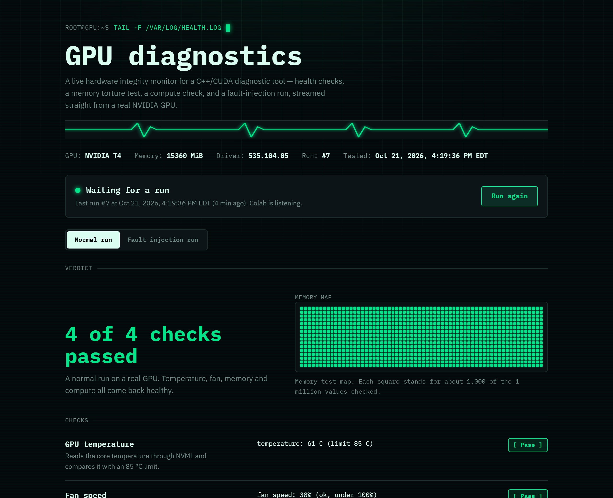
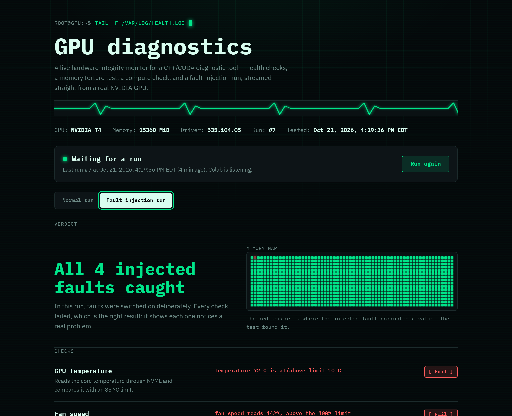
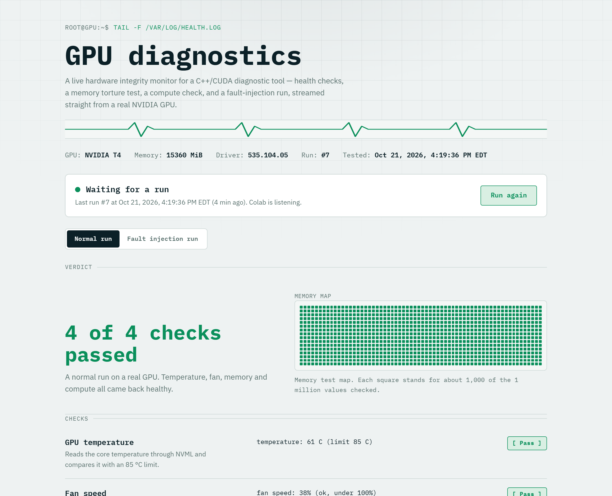

# GPU Diagnostics

**A live hardware integrity monitor for a C++/CUDA GPU diagnostic tool.**

 

 

A real NVIDIA GPU, in Colab, runs a diagnostic engine written in C++ and CUDA. It checks
temperature and fan speed through NVML, torture-tests a million values of GPU memory, and
verifies a million GPU compute results against the CPU — then it can deliberately break
every one of those checks on purpose, just to prove each one actually catches the failure it
claims to catch. This page shows the results, live, and can ask Colab to run it all again.

## What it checks

| Check | What it does |
|---|---|
| **GPU temperature** | Reads the core temperature through NVML and compares it with an 85 °C limit. |
| **Fan speed** | Reads the fan speed and rejects impossible values above 100%. |
| **Memory pattern test** | Writes four bit patterns into 1,000,000 values of GPU memory, then reads every value back. |
| **Compute check** | Adds 1,000,000 pairs of numbers on the GPU and checks every answer on the CPU. |
| **Fault injection** | Deliberately corrupts the run above, so you can see that every check actually fails when it should. |

 Fault injection on — every check correctly fails, and the corrupted cell lights up red in the memory map.

## Architecture

Three pieces, one direction of trust: **Colab only ever calls *out*** to the website. It never
opens a port, needs a tunnel, or exposes a public address.

1. **Colab notebook** compiles and runs `diag.cu` against a real GPU, then polls `/api/poll`
   every 5 seconds to ask "has someone requested a run?"
2. If the website answers `{ run: true }`, Colab runs the diagnostics and `POST`s the results
   to `/api/results`.
3. **Vercel** hosts this static page plus four serverless functions, and is the only thing
   that talks to storage.
4. **Upstash Redis** (free tier, attached via Vercel Storage) holds the latest `results` and
   `status` as JSON — nothing else.
5. Your **browser** polls `/api/status` and `/api/results` (public, read-only) to keep the
   page live, and can `POST /api/run` to ask for a fresh run — which requires the deploy key.

## Files

| File | Role |
|---|---|
| [`index.html`](index.html) | The dashboard — this page |
| [`api/results.js`](api/results.js) | `GET` the latest results, or `POST` new ones |
| [`api/status.js`](api/status.js) | `GET` what's happening right now |
| [`api/run.js`](api/run.js) | `POST` to trigger the **Run again** button |
| [`api/poll.js`](api/poll.js) | Colab checks in here every 5 seconds while listening |
| [`lib/store.js`](lib/store.js) | Redis read/write helpers, and the deploy-key check |
| [`gpu_diagnostics_cpp.ipynb`](gpu_diagnostics_cpp.ipynb) | The Colab notebook: builds `diag.cu`, runs it, and talks to the website |
| [`docs/architecture.svg`](docs/architecture.svg) | The diagram above |

## Set up (once)

1. **Deploy.** Put this folder in a GitHub repository. On vercel.com, choose **Add New →
   Project**, import the repository, and click **Deploy**. Leave all settings as they are.
2. **Add storage.** In your Vercel project, open **Storage**, choose **Upstash for Redis**
   (free plan), create a database, and connect it to this project.
3. **Make a deploy key.** In **Settings → Environment Variables**, add `DEPLOY_KEY` with a
   password you make up. Only someone with this key can send results or click **Run again**.
4. **Redeploy.** In **Deployments**, open the latest one and click **Redeploy**, so the new
   settings take effect.
5. **Connect Colab.** Click the key icon in the left sidebar, add a secret named `DEPLOY_KEY`
   with the same password, and switch on **Notebook access**. Put your website address in
   step 6 of the notebook.

## Use it

- In Colab, run steps 1–7. In the control panel, click **Deploy to website** to send fresh
  results.
- To trigger a run *from* the website: click **Start listening for runs** in Colab, then
  **Run again** on the site. The first time, the site asks for your deploy key and remembers
  it in that browser only.
- Visitors without the key can view results but can't start runs.
- Colab only listens while the notebook is open. When it isn't, the website still shows the
  last results.

 

 Theme follows the system's light/dark preference automatically.

